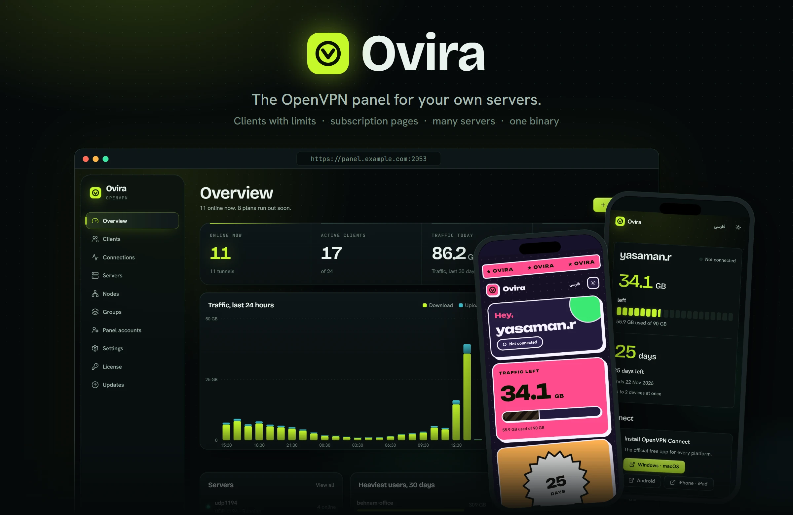
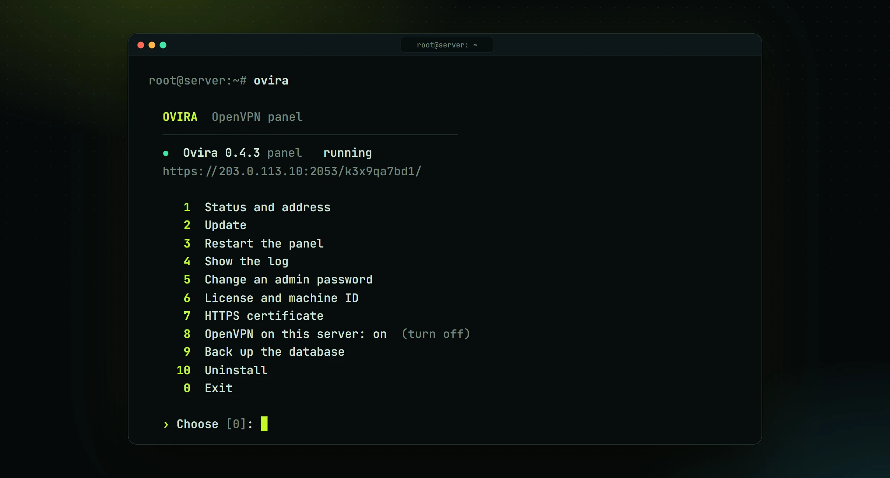
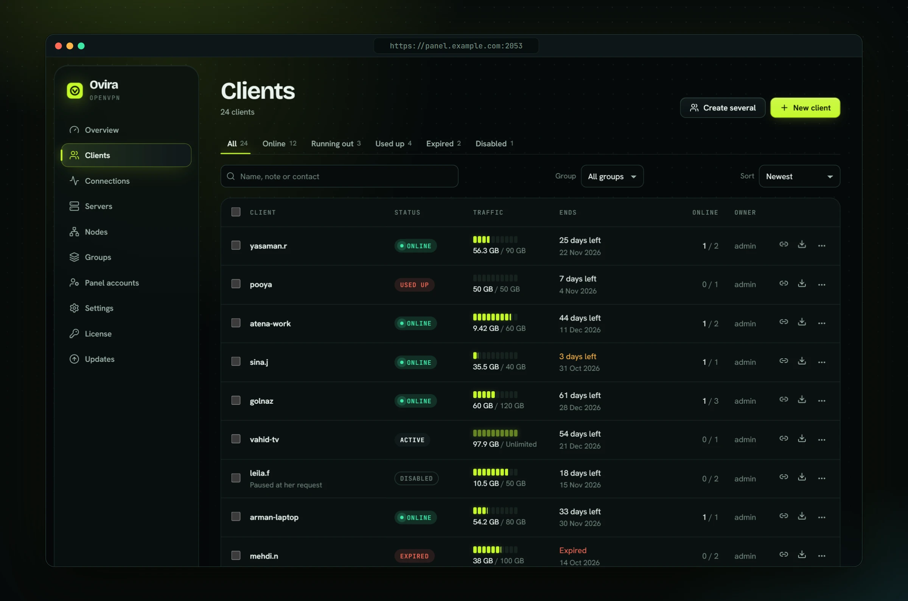
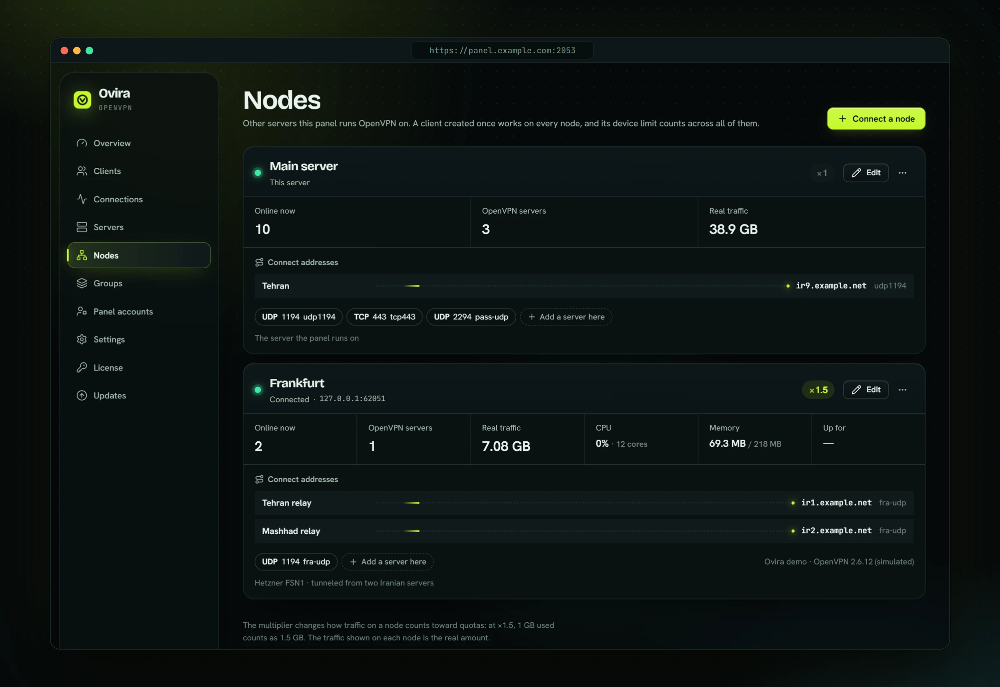
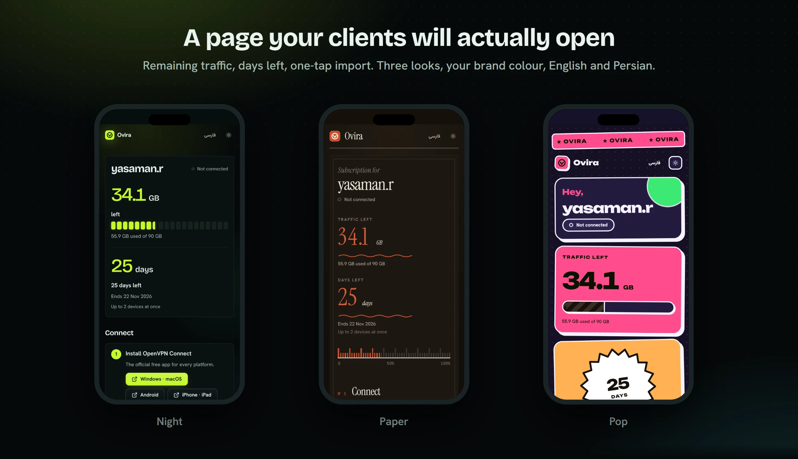
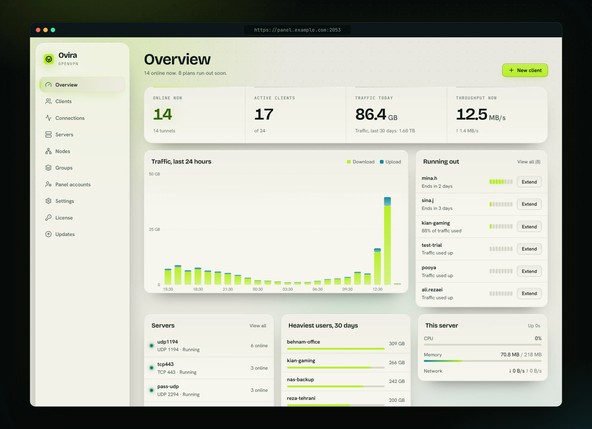
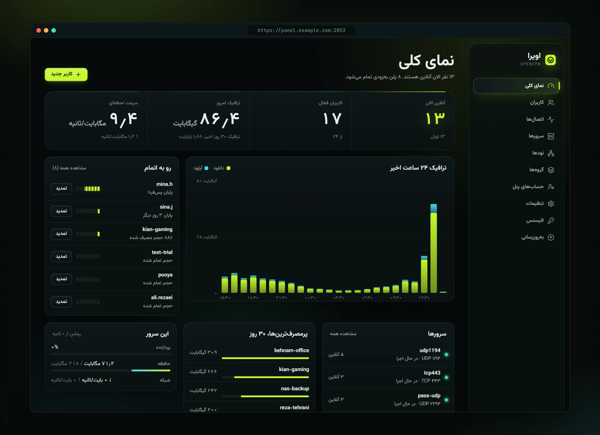
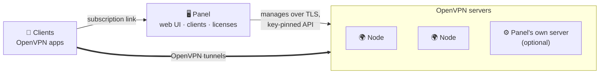

<div align="center">

<a href="https://erfan-xray.github.io/Ovira/fa/"></a>

<br>

[](https://github.com/Erfan-XRay/Ovira/releases/latest) [](https://github.com/Erfan-XRay/Ovira/releases) [](#نصب) [](#پلن‌ها)

**[مستندات](https://erfan-xray.github.io/Ovira/fa/)** &nbsp;·&nbsp; **[Documentation](https://erfan-xray.github.io/Ovira/)** &nbsp;·&nbsp; **[English README](README.md)** &nbsp;·&nbsp; **[Releases](https://github.com/Erfan-XRay/Ovira/releases)**

</div>

<br>

<div dir="rtl">

**اویرا** (Ovira) یک پنل VPN (OpenVPN، OpenConnect و WireGuard) برای سرورهای لینوکسی است: یک فایل اجرایی که رابط وب هم داخلش است. کاربر بسازید با محدودیت حجم و زمان، برای هر کدام لینک اشتراک بدهید و سرورهای محلی و راه دور را در محدودهٔ پلن خود از یک جا مدیریت کنید. بدون داکر، بدون راه‌اندازی دیتابیس، بدون ویرایش فایل تنظیمات.

<table dir="rtl">
<tr>
<td width="33%" valign="top">

### ⚡ یک دستور
یک اسکریپت پنل (یا نود) را نصب می‌کند، گواهی HTTPS می‌گیرد و اطلاعات ورود را چاپ می‌کند. بعد از آن دستور `ovira` روی سرور، منوی کنترل شماست.

</td>
<td width="33%" valign="top">

### 🌍 چند سرور
در چند دقیقه نود اضافه کنید. یک کاربر روی همهٔ آن‌ها کار می‌کند و محدودیت دستگاهش روی همهٔ سرورها با هم شمرده می‌شود.

</td>
<td width="33%" valign="top">

### 📱 کاربران دوستش دارند
هر کاربر صفحه‌ای دارد با حجم باقی‌مانده، روزهای مانده و اتصال با یک لمس، به فارسی و انگلیسی.

</td>
</tr>
</table>

## نصب

روی یک سرور تازهٔ **Debian 11+**، **Ubuntu 20.04+** یا **AlmaLinux / Rocky 8+** با root:

</div>

```bash
bash <(curl -fsSL https://raw.githubusercontent.com/Erfan-XRay/Ovira/main/install.sh)
```

<div dir="rtl">

اسکریپت خودش اویرا را می‌گیرد، پس لازم نیست چیزی از قبل کپی کنید، و می‌پرسد چه چیزی نصب شود:

| انتخاب | چیست |
|---|---|
| **پنل** | پنل وب. پورت را می‌پرسد، اینکه این سرور OpenVPN هم اجرا کند یا یک *پنل خالی* بماند که فقط نودها را مدیریت می‌کند، پورت‌های OpenVPN و روش HTTPS: گواهی Let's Encrypt برای دامنه، برای آی‌پی سرور، یا هیچ. بعد آدرس و رمز را چاپ می‌کند. |
| **نود** | یک سرور OpenVPN اضافه برای پنلی که جای دیگر اجرا می‌شود. در پنل، **نودها ← اتصال نود** دستور دقیق را آمادهٔ کپی نشان می‌دهد. |

هر دانلود قبل از نصب با **امضای نسخه** بررسی می‌شود. سؤال نمی‌خواهید؟ همه‌چیز را می‌شود به‌صورت گزینه داد؛ [راهنمای نصب](https://erfan-xray.github.io/Ovira/fa/guide/install) را ببینید.

</div>

<details>
<summary><b>نصب نود، پنل خالی یا اسکریپتی</b></summary>

<br>

```bash
# یک نود که فقط به پنل شما جواب می‌دهد
bash <(curl -fsSL https://raw.githubusercontent.com/Erfan-XRay/Ovira/main/node.sh) --panel-ip PANEL_IP

# پنل خالی که فقط نودها را مدیریت می‌کند
bash <(curl -fsSL https://raw.githubusercontent.com/Erfan-XRay/Ovira/main/install.sh) panel --panel-only

# بدون هیچ سؤالی
bash <(curl -fsSL https://raw.githubusercontent.com/Erfan-XRay/Ovira/main/install.sh) panel --yes \
  --port 8443 --ssl domain --domain panel.example.com --email you@example.com
```

<div dir="rtl">

پنل خالی را بعداً با `ovira openvpn enable` می‌شود به سرور OpenVPN هم تبدیل کرد.

</div>

</details>

<div dir="rtl">

## دستور `ovira`

بعد از نصب، `ovira` روی سرور یک منو باز می‌کند و هر گزینه یک دستور هم هست.

<p align="center"></p>

| دستور | کار |
|---|---|
| `ovira status` | نسخه، آدرس پنل، لایسنس، سرویس‌های در حال اجرا؛ خبر نسخهٔ جدید را هم می‌دهد |
| `ovira update` | نصب جدیدترین نسخه (پایدار یا `--beta`) |
| `ovira password` | رمز جدید برای یک ادمین: خودتان بنویسید یا یک رمز تصادفی قوی |
| `ovira license` | لایسنس و شناسهٔ دستگاه |
| `ovira ssl` | گواهی HTTPS برای دامنه یا آی‌پی |
| `ovira openvpn enable` | سرور خود پنل را هم سرور OpenVPN کنید (`disable` برای برگشت) |
| `ovira logs` · `restart` · `backup` · `uninstall` | همان‌طور که اسمشان می‌گوید |

## چه چیزی می‌گیرید

<table dir="rtl">
<tr>
<td width="50%" valign="top">

### 👥 کاربران
سهمیهٔ حجم، تاریخ پایان یا ساعتی که از اولین استفاده شروع می‌شود، دستگاه هم‌زمان، ریست دوره‌ای، آی‌پی ثابت و ساخت گروهی. کاربران را در **گروه** بگذارید تا تعیین شود کدام سرورها را می‌گیرند.

</td>
<td width="50%" valign="top">

### 🔐 OpenVPN کامل
سرورهای UDP و TCP کنار هم، ورود با گواهی و/یا رمز، tls-crypt، انتخاب رمزنگاری، تونل کامل یا تقسیم‌شده، IPv6.

### 🌐 OpenConnect (سیسکو)
سرورهای OpenConnect کنار OpenVPN، روی پنل یا نودها. کاربران با Cisco Secure Client یا برنامه‌های OpenConnect و همان نام و رمز وصل می‌شوند؛ استتار سرور را از اسکنرها پنهان می‌کند.

### ⚡ وایرگارد (WireGuard)
سرورهای وایرگارد روی پنل یا نودها، در حالت عادی یا حالت امنزیا برای شبکه‌هایی که وایرگارد را می‌بندند. هر دستگاه پیکربندی و کد QR خودش را دارد که روی همهٔ سرورهای مجاز کاربر کار می‌کند.

</td>
</tr>
<tr>
<td valign="top">

### 🛰️ نودها و سرورهای واسط
سرورهای بیشتری به یک پنل وصل کنید. هر نود ضریب ترافیک و آدرس‌های اتصال خودش را دارد، پس سرور واسط یا تونلِ جلوی آن به پروفایل‌هایی تبدیل می‌شود که کاربر می‌تواند انتخاب کند.

</td>
<td valign="top">

### 🔄 به‌روزرسانی که خبر می‌دهد
وقتی نسخهٔ جدید بیاید یک بنر در پنل ظاهر می‌شود؛ با یک کلیک نصب می‌شود و صفحه‌های باز بعد از پایان خودشان دوباره بارگذاری می‌شوند. کانال پایدار و بتا، به‌روزرسانی خودکار، نودها همراه پنل.

</td>
</tr>
<tr>
<td valign="top">

### 🎨 صفحهٔ اشتراک
سه ظاهر، نام و رنگ خودتان، دکمهٔ پشتیبانی، فارسی و انگلیسی. حجم باقی‌مانده، روزهای مانده، نمودار مصرف، اتصال با یک لمس.

</td>
<td valign="top">

### 🛡️ امن به‌صورت پیش‌فرض
رمزها با Argon2id، ورود دومرحله‌ای، مسیر مخفی پنل (هر چیز دیگر *404* می‌دهد)، گواهی HTTPS خودکار، نسخه‌های امضاشده.

</td>
</tr>
</table>

## ببینید

این تصاویر نمونه‌هایی از رابط کاربری‌اند. داده‌های کاربران و نام تجاری یا لینک پشتیبانی تنظیم‌شده توسط مالک، نمونه هستند؛ اویرا سرویس رسمی پشتیبانی تلگرام ندارد.

</div>

<p align="center">
  
</p>

<p align="center">
  
</p>

<p align="center">
  
</p>

<table>
<tr>
<td width="50%"></td>
<td width="50%"></td>
</tr>
<tr>
<td align="center"><sub>حالت روشن (پیش‌فرض تیره است)</sub></td>
<td align="center"><sub>فارسی، راست‌به‌چپ</sub></td>
</tr>
</table>

<div dir="rtl">

## اجزا چطور کنار هم قرار می‌گیرند

</div>



<div dir="rtl">

پنل ترافیک کاربران شما را عبور نمی‌دهد، مگر اینکه بگذارید سرور خودش هم OpenVPN اجرا کند. تونل‌ها روی نودهاست؛ کاربران، محدودیت‌ها و لایسنس‌ها پیش پنل.

## پلن‌ها

پلن رایگان **۵ کاربر فعال، ۲ نود راه دور و ۱ حساب پنل** دارد. حساب نمایندهٔ فروش در Pro و Business ارائه می‌شود. پلن‌های پولی پیش‌فرض از **۳ دلار در ماه** شروع می‌شوند. خرید داخل پنل با یکی از روش‌های پرداخت فعال انجام می‌شود و پس از تأیید پرداخت فعال‌سازی صورت می‌گیرد. شبکه و ارز موجود به سرویس پرداخت بستگی دارد.

| پلن | کاربر فعال | نود | پنل هم‌زمان | ماهانه |
|---|---|---|---|---|
| **رایگان** | ۵ | ۲ | ۱ | ۰ دلار |
| **Starter** | ۲۰۰ | ۳ | ۱ | ۳ دلار |
| **Pro** | ۸۰۰ | ۱۰ | ۲ | ۷ دلار |
| **Business** | نامحدود | نامحدود | ۳ | ۱۵ دلار |

این‌ها قیمت‌های پیش‌فرض‌اند؛ پیشنهادها، روش‌های پرداخت و سقف‌های فعلی را در صفحهٔ **لایسنس** پنل ببینید. برای تأیید فعال‌سازی، مهلت تمدید و انتقال سرور [راهنمای لایسنس](https://erfan-xray.github.io/Ovira/fa/guide/plans) را بخوانید.

## مستندات

| | |
|---|---|
| 🚀 [نصب](https://erfan-xray.github.io/Ovira/fa/guide/install) | پیش‌نیازها، گزینه‌ها، کار اسکریپت |
| 🧭 [قدم‌های اول](https://erfan-xray.github.io/Ovira/fa/guide/first-steps) | اولین کاربر و لینک اشتراک |
| 🌍 [نودها و سرورهای واسط](https://erfan-xray.github.io/Ovira/fa/guide/nodes) | سرورهای بیشتر، ضریب، آدرس‌های اتصال |
| 🧩 [گروه‌ها](https://erfan-xray.github.io/Ovira/fa/guide/groups) | کدام کاربر کدام سرورها را بگیرد |
| 🔄 [به‌روزرسانی](https://erfan-xray.github.io/Ovira/fa/guide/updates) | کانال‌ها، به‌روزرسانی خودکار، بنر داخل پنل |
| ⌨️ [خط فرمان](https://erfan-xray.github.io/Ovira/fa/guide/cli) | دستور `ovira` و منویش |
| 🛠️ [رفع مشکل](https://erfan-xray.github.io/Ovira/fa/guide/faq) | مشکل‌های رایج و راه‌حل |

## مجوز

اویرا نرم‌افزار اختصاصی است: فایل‌های اجرایی با پلن رایگان آزادانه قابل استفاده‌اند و پلن‌های پولی کلید لایسنس می‌خواهند. [LICENSE](LICENSE) را ببینید.

</div>

<div align="center">
<br>
<sub>ساخته‌شده با دقت توسط <a href="https://github.com/Erfan-XRay">Erfan-XRay</a> &nbsp;·&nbsp; <a href="https://github.com/Erfan-XRay/Ovira/releases">Releases</a> &nbsp;·&nbsp; <a href="https://erfan-xray.github.io/Ovira/fa/">مستندات</a></sub>
</div>
