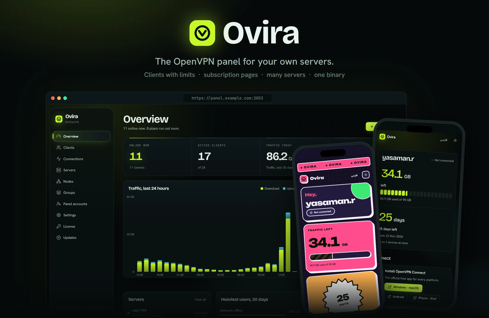
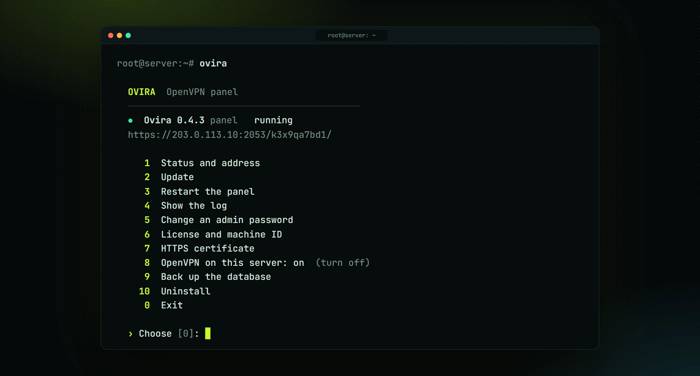
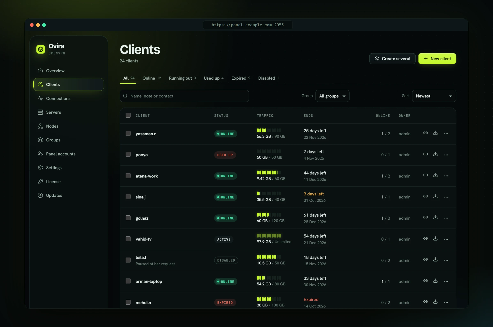
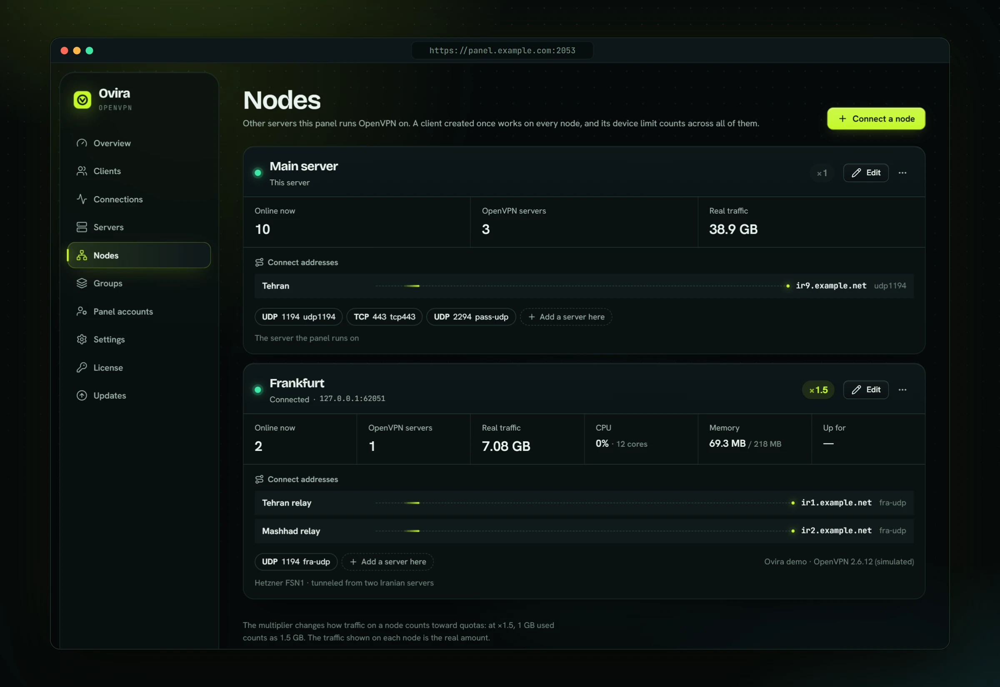
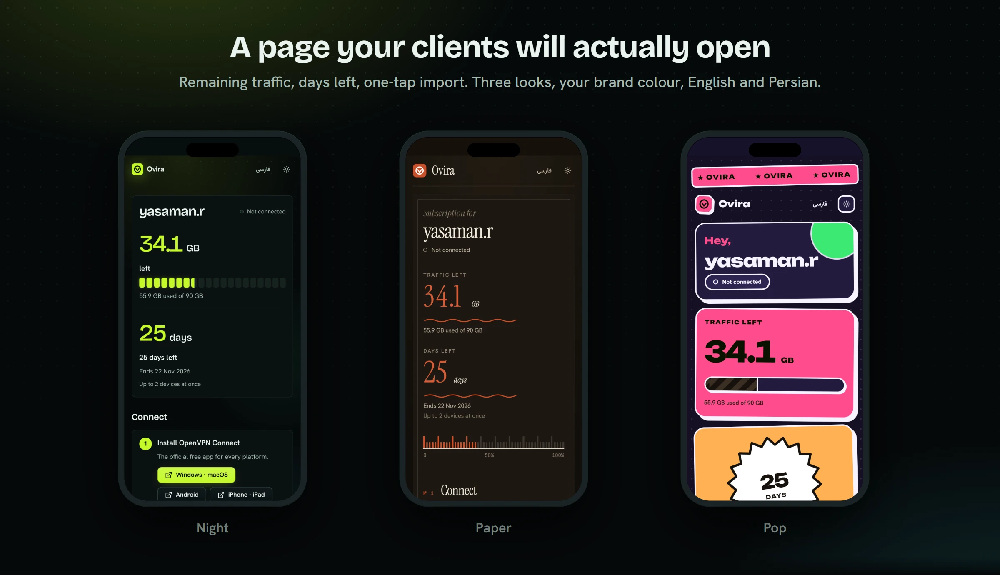
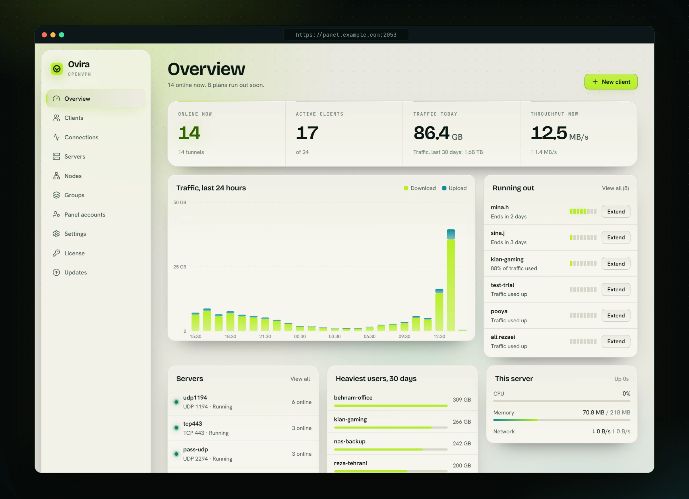
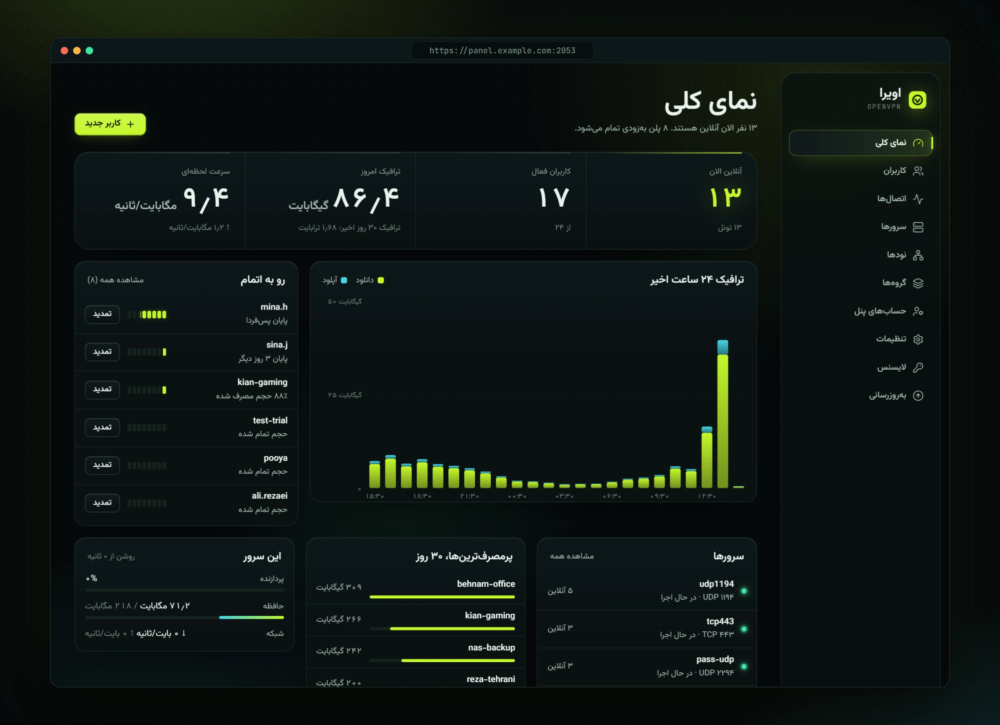
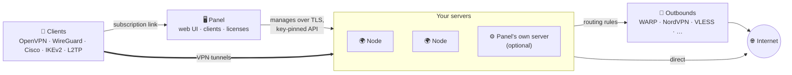

<div align="center">

<a href="https://erfan-xray.github.io/Ovira/fa/"></a>

<br>

[](https://github.com/Erfan-XRay/Ovira/releases/latest) [](https://github.com/Erfan-XRay/Ovira/releases) [](#نصب) [](#پلنها)

**[سایت و مستندات](https://erfan-xray.github.io/Ovira/fa/)** &nbsp;·&nbsp; **[Documentation](https://erfan-xray.github.io/Ovira/)** &nbsp;·&nbsp; **[English README](README.md)** &nbsp;·&nbsp; **[Releases](https://github.com/Erfan-XRay/Ovira/releases)**

</div>

<br>

<div dir="rtl">

**اویرا** (Ovira) یک پنل VPN برای سرورهای لینوکسی خودتان است: یک فایل اجرایی که رابط وب هم داخلش است. کاربر بسازید با محدودیت حجم و زمان، به هر کدام یک لینک اشتراک بدهید و **OpenVPN، WireGuard / AmneziaWG، OpenConnect، IKEv2 و L2TP/IPsec** را روی سرور خود پنل و روی هر تعداد نودی که پلنتان اجازه می‌دهد اجرا کنید. با **مسیریابی خروجی** ترافیک را از سرورهای دیگر بیرون بفرستید. بدون داکر، بدون راه‌اندازی دیتابیس، بدون ویرایش فایل تنظیمات.

> **اویرا ۱٫۰ منتشر شد.** مسیریابی خروجی با Cloudflare WARP و NordVPN با یک کلیک، IKEv2 و L2TP/IPsec، گواهی Let's Encrypt برای هر نود، پورت پنل قابل انتخاب و پورت جدا برای ساب. [تازه‌های ۱٫۰](#تازههای-۱۰) را ببینید.

<table dir="rtl">
<tr>
<td width="33%" valign="top">

### ⚡ یک دستور
یک اسکریپت پنل (یا نود) را نصب می‌کند، گواهی HTTPS می‌گیرد و اطلاعات ورود را چاپ می‌کند. بعد از آن دستور `ovira` روی سرور، منوی کنترل شماست.

</td>
<td width="33%" valign="top">

### 🌍 چند سرور
در چند دقیقه نود اضافه کنید. یک کاربر روی همهٔ آن‌ها کار می‌کند و سقف دستگاهش روی همهٔ سرورها و همهٔ پروتکل‌ها با هم شمرده می‌شود.

</td>
<td width="33%" valign="top">

### 📱 کاربران دوستش دارند
هر کاربر صفحه‌ای دارد با حجم باقی‌مانده، روزهای مانده، اتصال با یک لمس و فایل‌های آمادهٔ تنظیم، به فارسی و انگلیسی.

</td>
</tr>
</table>

## نصب

روی یک سرور تازهٔ **Debian 11+**، **Ubuntu 20.04+** یا **AlmaLinux / Rocky 8+** با root:

</div>

```bash
bash <(curl -fsSL https://raw.githubusercontent.com/Erfan-XRay/Ovira/main/install.sh)
```

<div dir="rtl">

اسکریپت خودش اویرا را می‌گیرد، پس لازم نیست چیزی از قبل کپی کنید، و می‌پرسد چه چیزی نصب شود:

| انتخاب | چیست |
|---|---|
| **پنل** | پنل وب. پورت پنل (پیش‌فرض `2053`)، پورت جداگانهٔ اختیاری برای ساب، اینکه این سرور خودش هم نود باشد یا نه، و روش HTTPS را می‌پرسد: گواهی Let's Encrypt برای دامنه، برای آی‌پی سرور، یا هیچ. بعد آدرس و رمز را چاپ می‌کند. |
| **نود** | یک سرور VPN اضافه برای پنلی که جای دیگر اجرا می‌شود. در پنل، **نودها ← اتصال نود** دستور دقیق را آمادهٔ کپی نشان می‌دهد. |

دانلودها با چک‌سام نسخه، و اگر سرور OpenSSL 3 داشته باشد با امضای نسخه هم، بررسی می‌شوند. سؤال نمی‌خواهید؟ همه‌چیز را می‌شود به‌صورت گزینه داد؛ [راهنمای نصب](https://erfan-xray.github.io/Ovira/fa/start/install-panel) را ببینید.

</div>

<details>
<summary><b>نصب نود، پنل خالی یا اسکریپتی</b></summary>

<br>

```bash
# یک نود که فقط به پنل شما جواب می‌دهد
bash <(curl -fsSL https://raw.githubusercontent.com/Erfan-XRay/Ovira/main/node.sh) --panel-ip PANEL_IP

# پنل خالی که فقط نودها را مدیریت می‌کند
bash <(curl -fsSL https://raw.githubusercontent.com/Erfan-XRay/Ovira/main/install.sh) panel --panel-only

# بدون هیچ سؤالی، لینک‌های ساب روی پورت جدا
bash <(curl -fsSL https://raw.githubusercontent.com/Erfan-XRay/Ovira/main/install.sh) panel --yes \
  --port 8443 --sub-port 2096 --ssl domain --domain panel.example.com --email you@example.com
```

<div dir="rtl">

نصب‌کننده هیچ اینباندی نمی‌سازد؛ اینباندها را در پنل، بخش «اینباندها»، بسازید و به یک نود وصل کنید. سرور فقط‌پنل را بعداً با `ovira local-node enable` می‌شود نود هم کرد.

</div>

</details>

<div dir="rtl">

## تازه‌های ۱٫۰

| | |
|---|---|
| **مسیریابی خروجی** | ترافیک کاربران VPN را برای هر نود از صفحهٔ جدید «مسیریابی» از طریق سرور دیگری بفرستید. خروجی VLESS، VMess، Trojan، Shadowsocks، Hysteria2، WireGuard، SOCKS یا HTTP را فیلدبه‌فیلد یا با لینک اضافه کنید و بر اساس فهرست سایت‌ها (geosite / geoip)، دامنه، IP، پورت یا اینباند مسیر بدهید، یا کل ترافیک را بفرستید. |
| **WARP و NordVPN** | ساخت خروجی Cloudflare WARP (رایگان یا WARP+) یا NordVPN (NordLynx) با یک کلیک. |
| **تست خروجی** | هر خروجی را از سرور اصلی یا یک نود تست کنید: وصل می‌شود یا نه، پینگ، و IP و کشور خروجی. |
| **IKEv2 و L2TP/IPsec** | دو پروتکل جدید برای کلاینت VPN داخلی گوشی‌ها و کامپیوترها، با فایل تنظیم آماده برای آیفون، آیپد، مک، اندروید و ویندوز. |
| **گواهی‌ها** | گرفتن گواهی Let's Encrypt برای نودها و سرور اصلی از صفحهٔ «گواهی‌ها» و استفاده در اینباندها و HTTPS پنل. خودشان تمدید می‌شوند. |
| **نودها** | فهرست ساده‌تر با پنل جزئیات؛ نصب و حذف پروتکل‌ها از پنل؛ به‌روزرسانی همهٔ نودها با هم. |
| **پورت پنل و پورت ساب** | پورت پنل را هنگام نصب انتخاب کنید و بعداً در «تنظیمات» عوض کنید؛ در صورت تمایل لینک‌های ساب را روی پورت جدا سرو کنید. |

پنل و نودها را با هم به‌روزرسانی کنید. یادداشت کامل در [صفحهٔ نسخه‌ها](https://github.com/Erfan-XRay/Ovira/releases/tag/v1.0.0) است.

## دستور `ovira`

بعد از نصب، `ovira` روی سرور یک منو باز می‌کند و هر گزینه یک دستور هم هست.

<p align="center"></p>

| دستور | کار |
|---|---|
| `ovira status` | نسخه، آدرس پنل، لایسنس، سرویس‌های در حال اجرا؛ خبر نسخهٔ جدید را هم می‌دهد |
| `ovira update` | نصب جدیدترین نسخه (پایدار یا `--beta`) |
| `ovira password` | رمز جدید برای یک ادمین: خودتان بنویسید یا یک رمز تصادفی قوی |
| `ovira license` | لایسنس و شناسهٔ دستگاه |
| `ovira ssl` | گواهی HTTPS برای دامنه یا آی‌پی |
| `ovira local-node enable` | سرور خود پنل را هم نود کنید (`disable` برای برگشت) |
| `ovira logs` · `restart` · `backup` · `uninstall` | همان‌طور که اسمشان می‌گوید |

## چه چیزی می‌گیرید

<table dir="rtl">
<tr>
<td width="50%" valign="top">

### 👥 کاربران
سهمیهٔ حجم، تاریخ پایان یا ساعتی که از اولین استفاده شروع می‌شود، دستگاه هم‌زمان، ریست دوره‌ای، آی‌پی ثابت و ساخت گروهی. کاربران را در **گروه** بگذارید تا تعیین شود کدام اینباندها را می‌گیرند.

### 🔐 پنج پروتکل، یک کاربر
| پروتکل | برنامه‌ها |
|---|---|
| **OpenVPN** (UDP / TCP) | OpenVPN Connect و برنامه‌های OpenVPN |
| **WireGuard / AmneziaWG** | WireGuard، AmneziaVPN |
| **OpenConnect** | Cisco Secure Client، برنامه‌های OpenConnect |
| **IKEv2** | داخلی در iOS، macOS، ویندوز، اندروید ۱۱ به بعد، strongSwan |
| **L2TP/IPsec** | داخلی در iOS، macOS و ویندوز |

</td>
<td width="50%" valign="top">

### 🧭 مسیریابی خروجی
برای هر نود انتخاب کنید کدام اینباندها مسیریابی شوند و ترافیکشان از کجا خارج شود: مستقیم، از طریق یک خروجی، یا مسدود. الگوهای آماده مثل «Gemini از خروجی» و «ایران مستقیم»؛ DNS و آدرس‌های خصوصی همیشه مستقیم می‌روند.

### 🛰️ نودها و سرورهای واسط
سرورهای بیشتری به یک پنل وصل کنید. هر نود ضریب ترافیک و آدرس‌های اتصال خودش را دارد، پس سرور واسطِ جلوی آن به پروفایل‌هایی تبدیل می‌شود که کاربر انتخاب می‌کند. پروتکل‌ها با وصل کردن اولین اینباند از خود پنل روی نود نصب می‌شوند.

### 🪪 گواهی‌ها
گواهی HTTPS پنل و همهٔ گواهی‌های OpenConnect و IKEv2 در یک صفحه، با تاریخ انقضا و تمدید خودکار.

</td>
</tr>
<tr>
<td valign="top">

### 🔄 به‌روزرسانی که خبر می‌دهد
وقتی نسخهٔ جدید بیاید یک بنر در پنل ظاهر می‌شود و با یک کلیک نصب می‌شود. کانال پایدار و بتا، به‌روزرسانی خودکار، نودها همراه پنل.

### 🧑‍💼 حساب‌های پنل و نمایندگان
به نماینده‌ها ورود جدا با سهمیهٔ ترافیک، تاریخ پایان و سقف کاربر بدهید و تعیین کنید کدام گروه‌ها و اینباندها را بفروشند.

</td>
<td valign="top">

### 🎨 صفحهٔ اشتراک
نام و رنگ خودتان، دکمهٔ پشتیبانی، فارسی و انگلیسی، تب‌های پروتکل با ترتیب و نام دلخواه. حجم باقی‌مانده، روزهای مانده، نمودار مصرف، اتصال با یک لمس و فایل‌های تنظیم.

### 🛡️ امن به‌صورت پیش‌فرض
رمزها با Argon2id، ورود دومرحله‌ای، مسیر مخفی پنل (هر چیز دیگر *404* می‌دهد)، HTTPS خودکار، نسخه‌های امضاشده، پشتیبان‌گیری در تلگرام و API با توکن‌های محدود.

</td>
</tr>
</table>

## ببینید

این تصاویر نمونه‌هایی از رابط کاربری‌اند. داده‌های کاربران و نام تجاری نمونه هستند.

</div>

<p align="center">
  
</p>

<p align="center">
  
</p>

<p align="center">
  
</p>

<table>
<tr>
<td width="50%"></td>
<td width="50%"></td>
</tr>
<tr>
<td align="center"><sub>حالت روشن (پیش‌فرض تیره است)</sub></td>
<td align="center"><sub>فارسی، راست‌به‌چپ</sub></td>
</tr>
</table>

<div dir="rtl">

## اجزا چطور کنار هم قرار می‌گیرند

</div>



<div dir="rtl">

پنل ترافیک کاربران شما را عبور نمی‌دهد، مگر اینکه بگذارید سرور خودش هم نود باشد. تونل‌ها و قوانین مسیریابی روی نودهاست؛ کاربران، محدودیت‌ها و لایسنس‌ها پیش پنل.

## پلن‌ها

پلن رایگان **۵ کاربر فعال، ۲ نود راه دور و ۱ حساب پنل** دارد. پلن‌های پولی کاربر، نود و حساب پنل بیشتری برای نمایندگان می‌دهند و از **۱ دلار در ماه** شروع می‌شوند. خرید داخل پنل با یکی از روش‌های پرداخت فعال انجام می‌شود و پس از تأیید پرداخت فعال‌سازی صورت می‌گیرد.

| پلن | کاربر فعال | نود | حساب پنل | پنل هم‌زمان | ماهانه |
|---|---|---|---|---|---|
| **رایگان** | ۵ | ۲ | ۱ | ۱ | ۰ دلار |
| **Starter** | ۲۰۰ | ۳ | ۲ | ۱ | ۱ دلار |
| **Pro** | ۸۰۰ | ۱۰ | ۵ | ۲ | ۳ دلار |
| **Business** | نامحدود | نامحدود | نامحدود | ۳ | ۱۰ دلار |

همهٔ پروتکل‌ها و مسیریابی خروجی در همهٔ پلن‌ها، حتی رایگان، هستند. این‌ها پلن‌های پیش‌فرض‌اند؛ پیشنهادها، روش‌های پرداخت و سقف‌های فعلی را در صفحهٔ **لایسنس** پنل ببینید. [راهنمای لایسنس](https://erfan-xray.github.io/Ovira/fa/use/license) را بخوانید.

## مستندات

| | |
|---|---|
| 🚀 [نصب پنل](https://erfan-xray.github.io/Ovira/fa/start/install-panel) | پیش‌نیازها، گزینه‌ها، پورت‌ها، کار اسکریپت |
| 🧭 [اولین کاربر](https://erfan-xray.github.io/Ovira/fa/start/first-client) | اولین کاربر و لینک اشتراک |
| 🔐 [انتخاب پروتکل](https://erfan-xray.github.io/Ovira/fa/protocols/) | OpenVPN، WireGuard، OpenConnect، IKEv2، L2TP/IPsec |
| 🧭 [مسیریابی خروجی](https://erfan-xray.github.io/Ovira/fa/use/routing) | خروجی‌ها، WARP، NordVPN، قوانین و تست |
| 🌍 [نودها](https://erfan-xray.github.io/Ovira/fa/use/nodes) | سرورهای بیشتر، ضریب، آدرس‌های اتصال |
| 🪪 [گواهی‌ها](https://erfan-xray.github.io/Ovira/fa/use/certificates) | Let's Encrypt برای نودها و پنل |
| 🔌 [API](https://erfan-xray.github.io/Ovira/fa/api/) | توکن‌ها، endpointها و نمونهٔ ربات فروش |
| 🛠️ [عیب‌یابی](https://erfan-xray.github.io/Ovira/fa/reference/troubleshooting) | مشکل‌های رایج و راه‌حل |

## مجوز

اویرا نرم‌افزار اختصاصی است: فایل‌های اجرایی با پلن رایگان آزادانه قابل استفاده‌اند و پلن‌های پولی کلید لایسنس می‌خواهند. [LICENSE](LICENSE) را ببینید.

</div>

<div align="center">
<br>
<sub>ساخته‌شده با دقت توسط <a href="https://github.com/Erfan-XRay">Erfan-XRay</a> &nbsp;·&nbsp; <a href="https://github.com/Erfan-XRay/Ovira/releases">Releases</a> &nbsp;·&nbsp; <a href="https://erfan-xray.github.io/Ovira/fa/">مستندات</a></sub>
</div>
