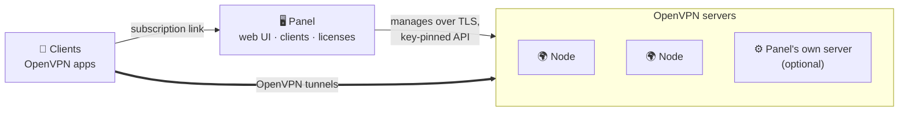

<div align="center">

<a href="https://erfan-xray.github.io/Ovira/"></a>

<br>

[](https://github.com/Erfan-XRay/Ovira/releases/latest) [](https://github.com/Erfan-XRay/Ovira/releases) [](#install) [](#plans)

**[Documentation](https://erfan-xray.github.io/Ovira/)** &nbsp;·&nbsp; **[مستندات فارسی](https://erfan-xray.github.io/Ovira/fa/)** &nbsp;·&nbsp; **[README فارسی](README.fa.md)** &nbsp;·&nbsp; **[Releases](https://github.com/Erfan-XRay/Ovira/releases)**

</div>

<br>

**Ovira** is a VPN panel (OpenVPN and OpenConnect) for Linux servers: one binary with the web UI built in. Create clients with traffic and time limits, hand each one a subscription link, and manage local and remote servers within your plan limits from a single place. No Docker, no database to set up, no config files to edit.

<table>
<tr>
<td width="33%" valign="top">

### ⚡ One command
A single script installs the panel (or a node), gets an HTTPS certificate and prints your login. Then `ovira` on the server is your control menu.

</td>
<td width="33%" valign="top">

### 🌍 Many servers
Add nodes in minutes. A client works on all of them, and its device limit counts across every server.

</td>
<td width="33%" valign="top">

### 📱 Clients love it
Each client gets a page with remaining traffic, days left and one-tap import, in English and Persian.

</td>
</tr>
</table>

## Install

On a fresh **Debian 11+**, **Ubuntu 20.04+** or **AlmaLinux / Rocky 8+** server, as root:

```bash
bash <(curl -fsSL https://raw.githubusercontent.com/Erfan-XRay/Ovira/main/install.sh)
```

The script downloads Ovira itself, so there is nothing to copy over first, and it asks what to install:

| Choose | What it is |
|---|---|
| **Panel** | The web panel. It asks for the port, whether this server should also run OpenVPN (or stay an *empty panel* that only manages nodes), the OpenVPN ports and how to get HTTPS: a Let's Encrypt certificate for your domain, for the server's IP, or none. Then it prints the address and your password. |
| **Node** | An extra OpenVPN server for a panel running elsewhere. In the panel, **Nodes → Connect a node** shows the exact command, ready to copy. |

Every download is checked against the **release signature** before anything is installed. Prefer no questions? Everything can be passed as options, see the [install guide](https://erfan-xray.github.io/Ovira/guide/install).

<details>
<summary><b>Install a node, an empty panel, or script it</b></summary>

<br>

```bash
# a node, answering only your panel
bash <(curl -fsSL https://raw.githubusercontent.com/Erfan-XRay/Ovira/main/install.sh) node --panel-ip PANEL_IP

# an empty panel that only manages nodes
bash <(curl -fsSL https://raw.githubusercontent.com/Erfan-XRay/Ovira/main/install.sh) panel --panel-only

# no questions at all
bash <(curl -fsSL https://raw.githubusercontent.com/Erfan-XRay/Ovira/main/install.sh) panel --yes \
  --port 8443 --ssl domain --domain panel.example.com --email you@example.com
```

An empty panel can become an OpenVPN server later with `ovira openvpn enable`.

</details>

## The `ovira` command

After installing, `ovira` opens a menu on the server, and every entry is also a command.

<p align="center"></p>

| Command | What it does |
|---|---|
| `ovira status` | Version, panel address, license, running services; tells you when an update is out |
| `ovira update` | Install the newest release (stable or `--beta`) |
| `ovira password` | New password for a panel admin: your own, or a strong random one |
| `ovira license` | License and machine ID |
| `ovira ssl` | HTTPS certificate for a domain or an IP |
| `ovira openvpn enable` | Make the panel's own server an OpenVPN server too (`disable` to undo) |
| `ovira logs` · `restart` · `backup` · `uninstall` | Exactly what they say |

## What you get

<table>
<tr>
<td width="50%" valign="top">

### 👥 Clients
Traffic allowance, an end date or a clock that starts at first use, devices at once, periodic resets, fixed IPs and bulk creation. Put clients in **groups** to decide which servers they get.

</td>
<td width="50%" valign="top">

### 🔐 OpenVPN, fully
UDP and TCP servers side by side, certificate and/or password sign-in, tls-crypt, cipher control, split or full tunnel, IPv6.

### 🌐 OpenConnect (Cisco)
Run OpenConnect servers next to OpenVPN, on the panel or on nodes. Clients use Cisco Secure Client or OpenConnect apps with the same name and password; camouflage hides the server from scanners.

</td>
</tr>
<tr>
<td valign="top">

### 🛰️ Nodes and relays
Connect more servers to one panel. Each node has its own traffic multiplier and its own connect addresses, so relays or tunnels in front of it become profiles clients can pick.

</td>
<td valign="top">

### 🔄 Updates that tell you
A banner appears in the panel when a new version is out; one click installs it, and open pages reload themselves when it is done. Stable and beta channels, automatic updates, nodes updated together with the panel.

</td>
</tr>
<tr>
<td valign="top">

### 🎨 Subscription pages
Three looks, your own name and accent colour, a support button, English and Persian. Remaining traffic, days left, usage chart, one-tap import.

</td>
<td valign="top">

### 🛡️ Secure by default
Argon2id passwords, two-factor sign-in, a secret panel path (everything else answers *404*), automatic HTTPS certificates, signed releases.

</td>
</tr>
</table>

## See it

These screenshots are examples of the interface. Client data and owner-configured branding or support links are illustrative; Ovira does not provide an official Telegram support service.

<p align="center">
  
</p>

<p align="center">
  
</p>

<p align="center">
  
</p>

<table>
<tr>
<td width="50%"></td>
<td width="50%"></td>
</tr>
<tr>
<td align="center"><sub>Light theme (dark is the default)</sub></td>
<td align="center"><sub>Persian, right to left</sub></td>
</tr>
</table>

## How the pieces fit



The panel never carries your clients' traffic unless you let its own server run OpenVPN too. Nodes hold the tunnels; the panel holds the clients, limits and licenses.

## Plans

The free plan allows **5 active clients, 2 remote nodes and 1 panel account**. Reseller accounts are included in Pro and Business. Default paid plans start at **$3 a month**. Buy inside the panel using a currently enabled payment method; activation follows confirmed payment. Payment networks and currencies depend on the checkout provider.

| Plan | Active clients | Nodes | Panels at once | Monthly |
|---|---|---|---|---|
| **Free** | 5 | 2 | 1 | $0 |
| **Starter** | 200 | 3 | 1 | $3 |
| **Pro** | 800 | 10 | 2 | $7 |
| **Business** | unlimited | unlimited | 3 | $15 |

These are default plan prices; check **License** in the panel for current offers, payment methods and limits. See the [license guide](https://erfan-xray.github.io/Ovira/guide/plans) for activation approval, renewal deadlines and server transfers.

## Documentation

| | |
|---|---|
| 🚀 [Install](https://erfan-xray.github.io/Ovira/guide/install) | Requirements, options, what the script does |
| 🧭 [First steps](https://erfan-xray.github.io/Ovira/guide/first-steps) | Your first client and subscription link |
| 🌍 [Nodes and relays](https://erfan-xray.github.io/Ovira/guide/nodes) | More servers, multipliers, connect addresses |
| 🧩 [Groups](https://erfan-xray.github.io/Ovira/guide/groups) | Which clients get which servers |
| 🔄 [Updates](https://erfan-xray.github.io/Ovira/guide/updates) | Channels, automatic updates, the in-panel banner |
| ⌨️ [Command line](https://erfan-xray.github.io/Ovira/guide/cli) | The `ovira` command and its menu |
| 🛠️ [Troubleshooting](https://erfan-xray.github.io/Ovira/guide/faq) | Common problems and fixes |

Every page is also available [in Persian](https://erfan-xray.github.io/Ovira/fa/).

## License

Ovira is proprietary software: the binaries are free to use under the free plan, and paid plans need a license key. See [LICENSE](LICENSE).

<div align="center">
<br>
<sub>Made with care by <a href="https://github.com/Erfan-XRay">Erfan-XRay</a> &nbsp;·&nbsp; <a href="https://github.com/Erfan-XRay/Ovira/releases">Releases</a> &nbsp;·&nbsp; <a href="https://erfan-xray.github.io/Ovira/">Docs</a></sub>
</div>
