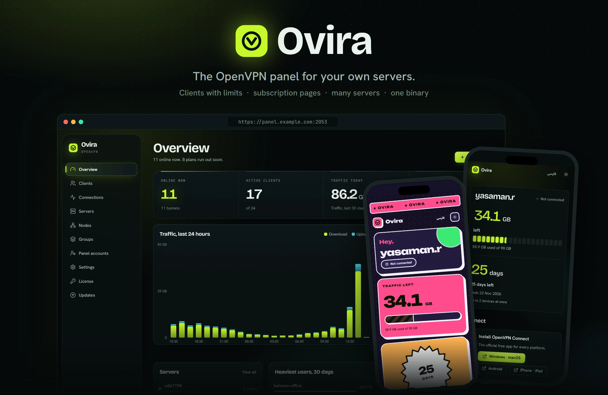
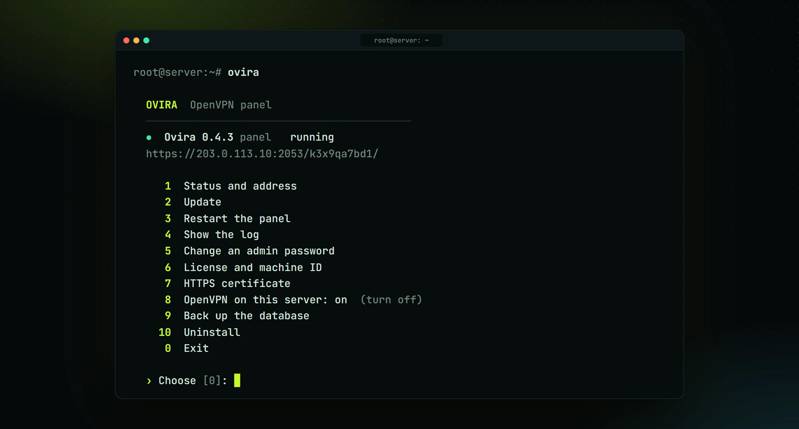
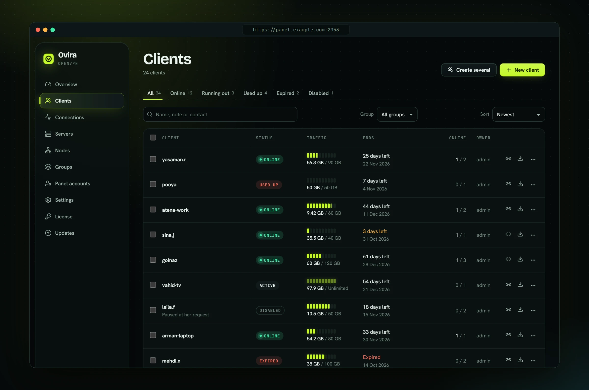
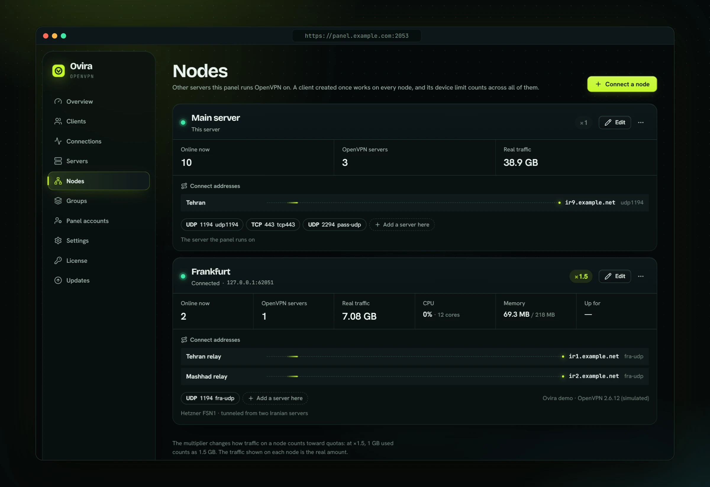
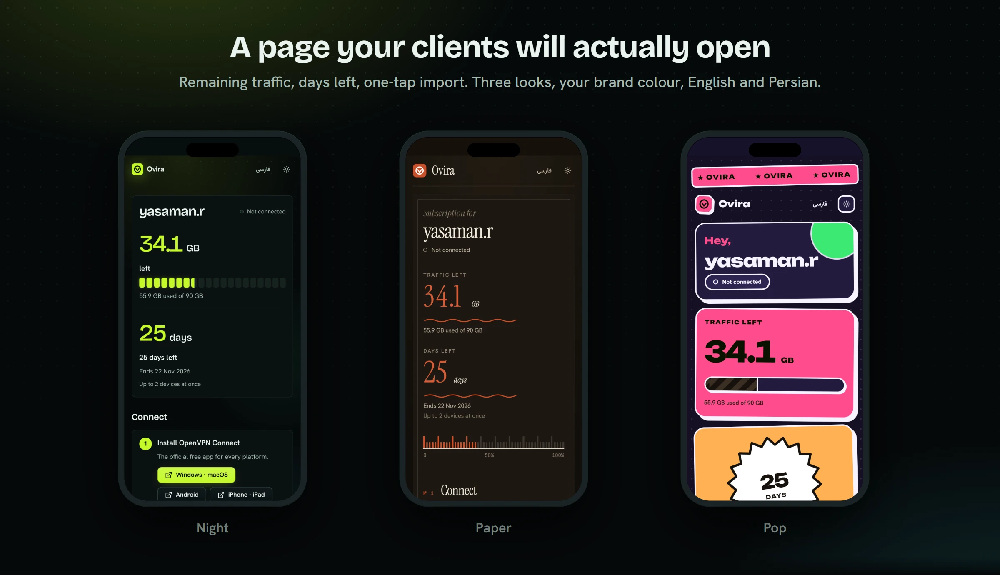
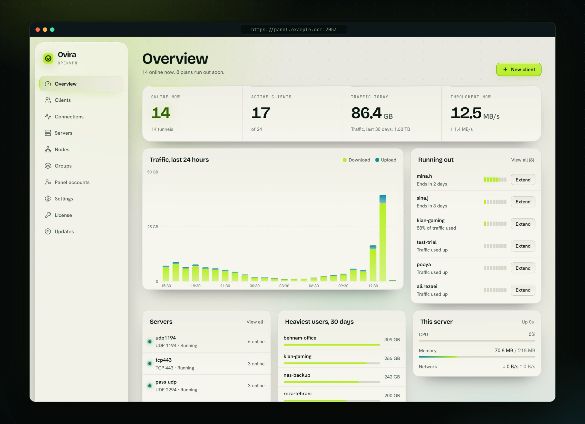
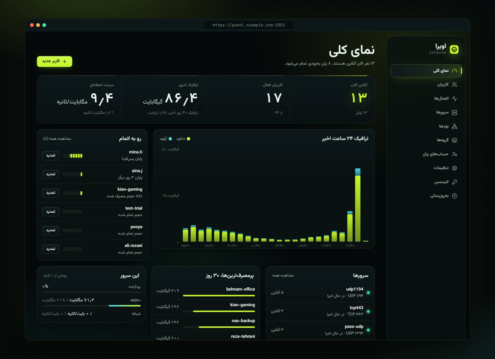
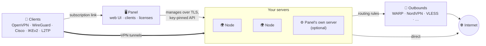

<div align="center">

<a href="https://erfan-xray.github.io/Ovira/"></a>

<br>

[](https://github.com/Erfan-XRay/Ovira/releases/latest) [](https://github.com/Erfan-XRay/Ovira/releases) [](#install) [](#plans)

**[Website & docs](https://erfan-xray.github.io/Ovira/)** &nbsp;·&nbsp; **[مستندات فارسی](https://erfan-xray.github.io/Ovira/fa/)** &nbsp;·&nbsp; **[README فارسی](README.fa.md)** &nbsp;·&nbsp; **[Releases](https://github.com/Erfan-XRay/Ovira/releases)**

</div>

<br>

**Ovira** is a self-hosted VPN panel for Linux servers: one binary with the web UI built in. Create clients with traffic and time limits, hand each one a single subscription link, and run **OpenVPN, WireGuard / AmneziaWG, OpenConnect, IKEv2 and L2TP/IPsec** on the panel's own server and on as many nodes as your plan allows. Send traffic out through other servers with **outbound routing**. No Docker, no database to set up, no config files to edit.

> **Ovira 1.0 is out.** Outbound routing with Cloudflare WARP and NordVPN in one click, IKEv2 and L2TP/IPsec, Let's Encrypt certificates for every node, a choosable panel port and a separate subscription port. See [what's new](#whats-new-in-10).

<table>
<tr>
<td width="33%" valign="top">

### ⚡ One command
A single script installs the panel (or a node), gets an HTTPS certificate and prints your login. Then `ovira` on the server is your control menu.

</td>
<td width="33%" valign="top">

### 🌍 Many servers
Add nodes in minutes. A client works on all of them, and its device limit counts across every server and every protocol.

</td>
<td width="33%" valign="top">

### 📱 Clients love it
Each client gets a page with remaining traffic, days left, one-tap import and ready-made setup files, in English and Persian.

</td>
</tr>
</table>

## Install

On a fresh server running **Ubuntu 22.04 or newer** (22.04, 24.04, 26.04), as root:

```bash
bash <(curl -fsSL https://raw.githubusercontent.com/Erfan-XRay/Ovira/main/install.sh)
```

The script downloads Ovira itself, so there is nothing to copy over first, and it asks what to install:

| Choose | What it is |
|---|---|
| **Panel** | The web panel. It asks for the panel port (default `2053`), an optional separate subscription port, whether this server is also a node, and how to get HTTPS: a Let's Encrypt certificate for your domain, for the server's IP, or none. Then it prints the address and your password. |
| **Node** | An extra VPN server for a panel running elsewhere. In the panel, **Nodes → Connect a node** shows the exact command, ready to copy. |

Downloads are checked against the release checksums, and against the release signature when the server has OpenSSL 3. Prefer no questions? Everything can be passed as options, see the [install guide](https://erfan-xray.github.io/Ovira/start/install-panel).

<details>
<summary><b>Install a node, an empty panel, or script it</b></summary>

<br>

```bash
# a node, answering only your panel
bash <(curl -fsSL https://raw.githubusercontent.com/Erfan-XRay/Ovira/main/node.sh) --panel-ip PANEL_IP

# a panel only, it manages other nodes
bash <(curl -fsSL https://raw.githubusercontent.com/Erfan-XRay/Ovira/main/install.sh) panel --panel-only

# no questions at all, subscription links on their own port
bash <(curl -fsSL https://raw.githubusercontent.com/Erfan-XRay/Ovira/main/install.sh) panel --yes \
  --port 8443 --sub-port 2096 --ssl domain --domain panel.example.com --email you@example.com
```

The installer creates no inbounds; create them in the panel under **Inbounds** and attach them to a node. A panel-only server can become a node later with `ovira local-node enable`.

</details>

## What's new in 1.0

| | |
|---|---|
| **Outbound routing** | Send your VPN clients' traffic out through another server, per node, from the new **Routing** page. Add VLESS, VMess, Trojan, Shadowsocks, Hysteria2, WireGuard, SOCKS or HTTP outbounds field by field or from a link, then route by site lists (geosite / geoip), domains, IPs, ports or inbound, or send everything. |
| **WARP and NordVPN** | Create a Cloudflare WARP (free or WARP+) or NordVPN (NordLynx) outbound in one click. |
| **Outbound test** | Test any outbound from the main server or a node: whether it connects, its latency, and the exit IP and country. |
| **IKEv2 and L2TP/IPsec** | Two new protocols for the VPN clients built into phones and computers, with downloadable setup files for iPhone, iPad, Mac, Android and Windows. |
| **Certificates** | Request Let's Encrypt certificates for nodes and the main server from the **Certificates** page, use them in inbounds and for the panel's HTTPS. They renew on their own. |
| **Nodes** | A simpler list with a details panel; install and remove protocols from the panel; update every node at once. |
| **Panel and subscription ports** | Choose the panel port at install and change it later in **Settings**; serve subscription links on a separate port if you like. |

Update the panel and its nodes together. The full notes are on the [releases page](https://github.com/Erfan-XRay/Ovira/releases/tag/v1.0.0).

## The `ovira` command

After installing, `ovira` opens a menu on the server, and every entry is also a command.

<p align="center"></p>

| Command | What it does |
|---|---|
| `ovira status` | Version, panel address, license, running services; tells you when an update is out |
| `ovira update` | Install the newest release (stable or `--beta`) |
| `ovira password` | New password for a panel admin: your own, or a strong random one |
| `ovira license` | License and machine ID |
| `ovira ssl` | HTTPS certificate for a domain or an IP |
| `ovira local-node enable` | Make the panel's own server a node too (`disable` to undo) |
| `ovira logs` · `restart` · `backup` · `uninstall` | Exactly what they say |

## What you get

<table>
<tr>
<td width="50%" valign="top">

### 👥 Clients
Traffic allowance, an end date or a clock that starts at first use, devices at once, periodic resets, fixed IPs and bulk creation. Put clients in **groups** to decide which inbounds they get.

### 🔐 Five protocols, one client
| Protocol | Apps |
|---|---|
| **OpenVPN** (UDP / TCP) | OpenVPN Connect and other OpenVPN apps |
| **WireGuard / AmneziaWG** | WireGuard, AmneziaVPN |
| **OpenConnect** | Cisco Secure Client, OpenConnect apps |
| **IKEv2** | Built into iOS, macOS, Windows, Android 11+, strongSwan |
| **L2TP/IPsec** | Built into iOS, macOS and Windows |

</td>
<td width="50%" valign="top">

### 🧭 Outbound routing
Per node, choose which inbounds are routed and where their traffic leaves: directly, through an outbound, or blocked. Ready-made presets such as *Gemini via outbound* and *Iran direct*; DNS and private addresses always stay direct.

### 🛰️ Nodes and relays
Connect more servers to one panel. Each node has its own traffic multiplier and connect addresses, so relays in front of it become profiles clients can pick. Protocols install on a node from the panel when you attach the first inbound.

### 🪪 Certificates
The panel's HTTPS certificate and every OpenConnect and IKEv2 certificate on one page, with expiry and automatic renewal.

</td>
</tr>
<tr>
<td valign="top">

### 🔄 Updates that tell you
A banner appears in the panel when a new version is out; one click installs it. Stable and beta channels, automatic updates, nodes updated together with the panel.

### 🧑‍💼 Panel accounts and resellers
Give resellers their own login with a traffic pool, an end date and a client limit, and choose which groups and inbounds they can hand out.

</td>
<td valign="top">

### 🎨 Subscription pages
Your own name and accent colour, a support button, English and Persian, protocol tabs you can reorder or rename. Remaining traffic, days left, usage chart, one-tap import and setup files.

### 🛡️ Secure by default
Argon2id passwords, two-factor sign-in, a secret panel path (everything else answers *404*), automatic HTTPS, signed releases, backups to Telegram and an API with scoped tokens.

</td>
</tr>
</table>

## See it

These screenshots are examples of the interface. Client data and branding are illustrative.

<p align="center">
  
</p>

<p align="center">
  
</p>

<p align="center">
  
</p>

<table>
<tr>
<td width="50%"></td>
<td width="50%"></td>
</tr>
<tr>
<td align="center"><sub>Light theme (dark is the default)</sub></td>
<td align="center"><sub>Persian, right to left</sub></td>
</tr>
</table>

## How the pieces fit



The panel never carries your clients' traffic unless you let its own server be a node too. Nodes hold the tunnels and apply the routing rules; the panel holds the clients, limits and licenses.

## Plans

The free plan allows **5 active clients, 2 remote nodes and 1 panel account**. Paid plans add more clients, nodes and panel accounts for resellers. Default paid plans start at **$1 a month**. Buy inside the panel using a currently enabled payment method; activation follows confirmed payment.

| Plan | Active clients | Nodes | Panel accounts | Panels at once | Monthly |
|---|---|---|---|---|---|
| **Free** | 5 | 2 | 1 | 1 | $0 |
| **Starter** | 200 | 3 | 2 | 1 | $1 |
| **Pro** | 800 | 10 | 5 | 2 | $3 |
| **Business** | unlimited | unlimited | unlimited | 3 | $10 |

Every protocol and outbound routing are on every plan, including Free. These are default plans; check **License** in the panel for current offers, payment methods and limits. See the [license guide](https://erfan-xray.github.io/Ovira/use/license).

## Documentation

| | |
|---|---|
| 🚀 [Install the panel](https://erfan-xray.github.io/Ovira/start/install-panel) | Requirements, options, ports, what the script does |
| 🧭 [Your first client](https://erfan-xray.github.io/Ovira/start/first-client) | Your first client and subscription link |
| 🔐 [Choosing a protocol](https://erfan-xray.github.io/Ovira/protocols/) | OpenVPN, WireGuard, OpenConnect, IKEv2, L2TP/IPsec |
| 🧭 [Outbound routing](https://erfan-xray.github.io/Ovira/use/routing) | Outbounds, WARP, NordVPN, rules and tests |
| 🌍 [Nodes](https://erfan-xray.github.io/Ovira/use/nodes) | More servers, multipliers, connect addresses |
| 🪪 [Certificates](https://erfan-xray.github.io/Ovira/use/certificates) | Let's Encrypt for nodes and the panel |
| 🔌 [API](https://erfan-xray.github.io/Ovira/api/) | Tokens, endpoints and a shop-bot example |
| 🛠️ [Troubleshooting](https://erfan-xray.github.io/Ovira/reference/troubleshooting) | Common problems and fixes |

Every page is also available [in Persian](https://erfan-xray.github.io/Ovira/fa/).

## License

Ovira is proprietary software: the binaries are free to use under the free plan, and paid plans need a license key. See [LICENSE](LICENSE).

<div align="center">
<br>
<sub>Made with care by <a href="https://github.com/Erfan-XRay">Erfan-XRay</a> &nbsp;·&nbsp; <a href="https://github.com/Erfan-XRay/Ovira/releases">Releases</a> &nbsp;·&nbsp; <a href="https://erfan-xray.github.io/Ovira/">Docs</a></sub>
</div>
